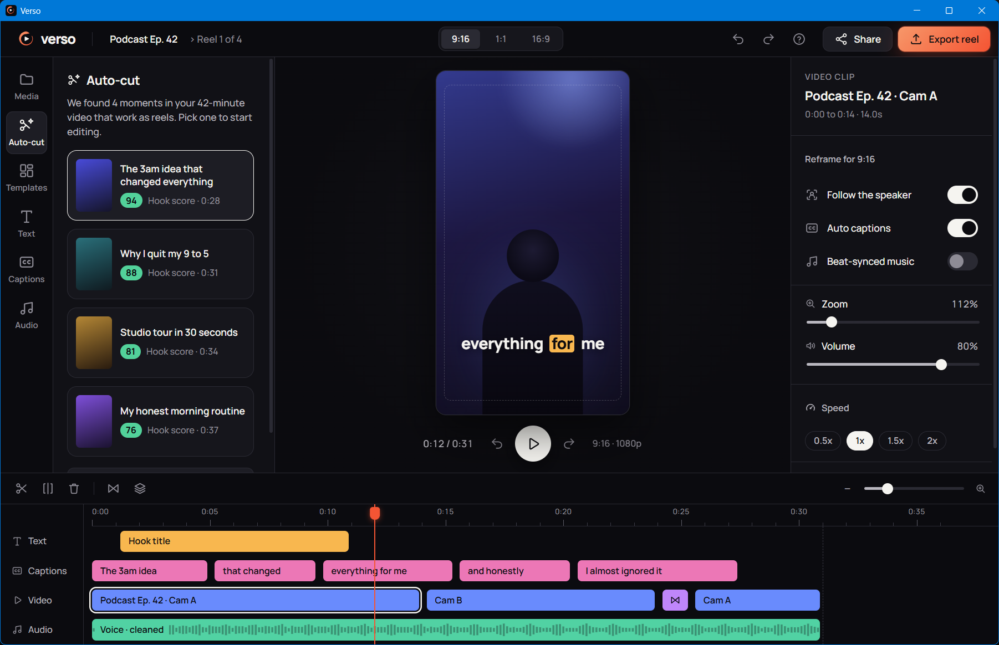

# Verso

**Long videos in. Reels out.**

Verso is a reels-first desktop video editor by Agape Labs, a brand of Exaltes Global Private Limited.
It's built for creators who have never opened a timeline. Verso finds the best moments in a long video,
turns them vertical, and finishes them in one click.

> Status: **Phase 1, Foundation (beta).** This phase is the app shell: Welcome screen, editor layout, and
> a working frontend-to-Rust pipeline that reads real files with ffprobe. It has no media engine yet:
> the preview and timeline use placeholder data.



## Stack

| Layer    | Tech                                                    |
| -------- | ------------------------------------------------------- |
| Shell    | [Tauri 2](https://tauri.app) (Windows now, macOS ready) |
| Backend  | Rust (stable, MSVC toolchain on Windows)                |
| Frontend | React 19 + TypeScript + Vite                            |
| Styling  | Plain CSS on the Verso design tokens (brand kit)        |
| Media    | FFmpeg 9.0 LGPL build, bundled as Tauri sidecars        |
| Package  | pnpm                                                    |

## Dev setup

Prerequisites:

1. **Node.js 20+** and **pnpm** (`npm i -g pnpm`).
2. **Rust** via [rustup](https://rustup.rs) (stable).
3. **Windows:** Visual Studio Build Tools with the "Desktop development with C++" workload, plus the
   WebView2 runtime (preinstalled on Windows 11).
   **macOS:** Xcode Command Line Tools (`xcode-select --install`).
4. **FFmpeg sidecars:** run `pnpm fetch:ffmpeg` once. It downloads the LGPL build into `src-tauri/binaries/` (see [FFmpeg and licensing](#ffmpeg-and-licensing)). Until then, dev builds fall back to `ffmpeg`/`ffprobe` on your PATH.

Then:

```bash
pnpm install
pnpm tauri dev
```

The first run compiles the Rust side and takes a few minutes. Later runs are fast.

## Scripts

| Command             | What it does                                     |
| ------------------- | ------------------------------------------------ |
| `pnpm tauri dev`    | Run the desktop app with hot reload              |
| `pnpm tauri build`  | Build installers (`.msi`/`.exe`, `.dmg` on Mac)  |
| `pnpm dev`          | Run only the web UI in a browser (no Rust calls) |
| `pnpm typecheck`    | TypeScript check                                 |
| `pnpm lint`         | ESLint                                           |
| `pnpm format`       | Prettier (write)                                 |
| `pnpm test:rust`    | Rust unit tests                                  |
| `pnpm fmt:rust`     | rustfmt                                          |
| `pnpm fetch:ffmpeg` | Download the LGPL FFmpeg sidecars (once)         |
| `pnpm build:app`    | Fetch sidecars, then build installers with them  |

## Architecture

```
verso/
├─ src/                       React UI
│  ├─ main.tsx                Entry: Manrope font, design tokens, app styles
│  ├─ App.tsx                 Splash, Welcome ↔ Editor, import flow, toasts
│  ├─ screens/
│  │  ├─ Welcome.tsx          Big actions: Make clips, Import video, New project
│  │  └─ Editor.tsx           Editor state (tab, aspect, playhead, zoom, selection)
│  ├─ components/
│  │  ├─ editor/              TopBar, LeftPanel (rail + tabs), Preview, Inspector, Timeline
│  │  ├─ Icon.tsx             Brand-kit SVG icons (currentColor)
│  │  ├─ Splash.tsx           Launch splash
│  │  └─ ui.tsx               Button, IconButton, Toggle, Segmented, Toast
│  ├─ lib/media.ts            File dialog + invoke("probe_media") + formatters
│  ├─ data/placeholder.ts     Sample project data until the engine lands
│  ├─ styles/
│  │  ├─ verso-tokens.css     Brand kit tokens: the single source of styling
│  │  └─ app.css              App styles, built only from tokens
│  └─ assets/                 Icons, logo, splash (from Verso-Brand-Kit)
├─ src-tauri/                 Rust backend
│  ├─ src/lib.rs              Builder: plugins (dialog, opener) + command registry
│  ├─ src/commands/
│  │  ├─ mod.rs               One module per area
│  │  ├─ media.rs             probe_media: runs ffprobe, returns MediaInfo JSON
│  │  └─ thumbnails.rs        media_filmstrip: cached frames for the media bin and timeline
│  ├─ src/tools.rs            Finds the FFmpeg sidecar (falls back to PATH in dev)
│  ├─ binaries/               FFmpeg sidecars from `pnpm fetch:ffmpeg` (git-ignored)
│  ├─ capabilities/           Tauri permissions (core, dialog, opener)
│  ├─ icons/                  App icons from the brand kit
│  └─ tauri.conf.json         Window, bundle and identifier config
└─ docs/screenshots/
```

### Frontend ↔ Rust

```
Import button ─► @tauri-apps/plugin-dialog open()
              ─► invoke("probe_media", { path })
              ─► Rust: ffprobe -show_format -show_streams (blocking thread)
              ─► MediaInfo { durationSec, width, height, fps, videoCodec, audioCodec, ... }
              ─► media bin card
```

Error messages from Rust are written in plain language and shown directly in a toast.

### Design rules (from the brand kit)

- Dark-first "Studio dark": Ink `#0B0B0F` background, Manrope everywhere (bundled, no CDN).
- **Ember `#FF4A2B` is used only for the primary action (Export) and the playhead.**
- Icons come from `03-Iconography` and take the colour of their text.
- Plain language, sentence case, verbs on buttons. Undo everything; never touch the original file.

## FFmpeg and licensing

Verso uses FFmpeg to read, preview and (later) export video. FFmpeg runs as a separate program (a Tauri
**sidecar**); it is never linked into Verso's own code.

- **Build:** [BtbN/FFmpeg-Builds](https://github.com/BtbN/FFmpeg-Builds), release branch **n9.0**, **LGPL**
  variant (`ffmpeg-n9.0-latest-win64-lgpl-9.0.zip`).
- **Why LGPL, not GPL:** the "full"/GPL builds include GPL-only encoders (x264, x265 and others). Shipping
  them would put Verso itself under GPL obligations. The LGPL build lets Verso stay closed source and
  freemium, as long as we:
  1. ship FFmpeg as its own replaceable executable (the sidecar does this),
  2. include the FFmpeg licence text (`licenses/FFMPEG-LICENSE.txt` in the installer), and
  3. credit FFmpeg and point to its source code (planned for the About panel).
- **H.264 export:** the LGPL build has no x264. Export (a later phase) will use hardware encoders (NVENC,
  Quick Sync, AMF, and VideoToolbox on Mac), which the LGPL build includes. Check H.264/HEVC patent
  licensing separately before a paid launch.
- **Download step:** `pnpm fetch:ffmpeg` (`scripts/fetch-ffmpeg.mjs`) downloads the archive, verifies it
  against the release's `checksums.sha256`, and installs `ffmpeg-<target-triple>.exe` and
  `ffprobe-<target-triple>.exe` in `src-tauri/binaries/`. That folder is git-ignored, so binaries are never
  committed.
- **Release builds:** `pnpm build:app` fetches the sidecars, then runs `tauri build` with
  `src-tauri/tauri.sidecar.conf.json`, which adds them as `externalBin` and bundles the licence.
- **macOS:** BtbN has no Mac builds. Before the Mac release, build FFmpeg with `--disable-gpl` (and without
  `--enable-nonfree`), then place `ffmpeg-<mac-triple>` and `ffprobe-<mac-triple>` in `src-tauri/binaries/`.

At runtime, `src-tauri/src/tools.rs` looks for the sidecar next to the Verso executable first, then falls
back to PATH (development only).

## Roadmap

1. **Foundation** (done): shell, design system, Rust command pipeline.
2. Media engine (in progress): FFmpeg sidecar, real thumbnails and filmstrips, real clips on the timeline,
   preview playback, waveforms, timeline editing.
3. Auto-cut and reframe: find moments in long videos, follow the speaker, 9:16 cutout.
4. Captions, templates and one-click edits.
5. Export, freemium licensing, auto-update, macOS build and signing.

## Backend

Accounts, entitlements and payments live in [`server/`](server/), a standalone Node.js 20+ package
(Fastify, TypeScript, Knex). It serves the hosted sign-in, account and pricing pages, the desktop
sign-in flow (system browser to `127.0.0.1` loopback with PKCE), `GET /v1/me/entitlements` with a signed
offline token, and Razorpay subscription webhooks.

```bash
cd server
pnpm install
pnpm dev        # http://localhost:8787, SQLite, emails printed to the console, no keys needed
pnpm build      # compile to dist/
pnpm start      # run dist/index.js
pnpm migrate    # apply database migrations (dev auto-migrates SQLite on start)
pnpm test
```

Copy `server/.env.example` to `server/.env` to change settings. Where each production key comes from, and how
to deploy to Hostinger Cloud Economy with MySQL, is in [docs/SETUP-KEYS.md](docs/SETUP-KEYS.md).

### Connecting the app

Copy the root `.env.example` to `.env.local`. In dev the app talks to `http://localhost:8787` by default; set
`VITE_VERSO_API_URL` for anything else. With no API URL the app runs offline on the Free plan and account screens
say "Sign-in isn't set up yet". Sign-in stores the refresh token in the OS keychain; the plan is cached as a
signed offline token in app data. `pnpm invite:create` (in `server/`) makes closed-beta invite codes for
`VITE_VERSO_BETA_GATE=true` builds.

## Releases

Installers, auto-updates, code signing and CI are covered in [docs/RELEASE.md](docs/RELEASE.md).

---

© 2026 Exaltes Global Private Limited. All rights reserved.
